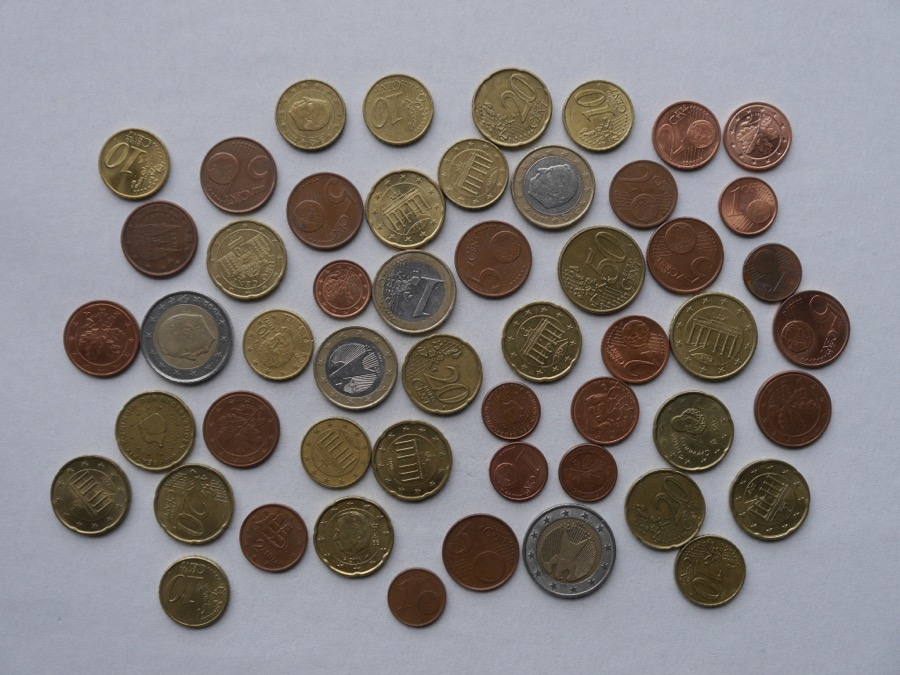
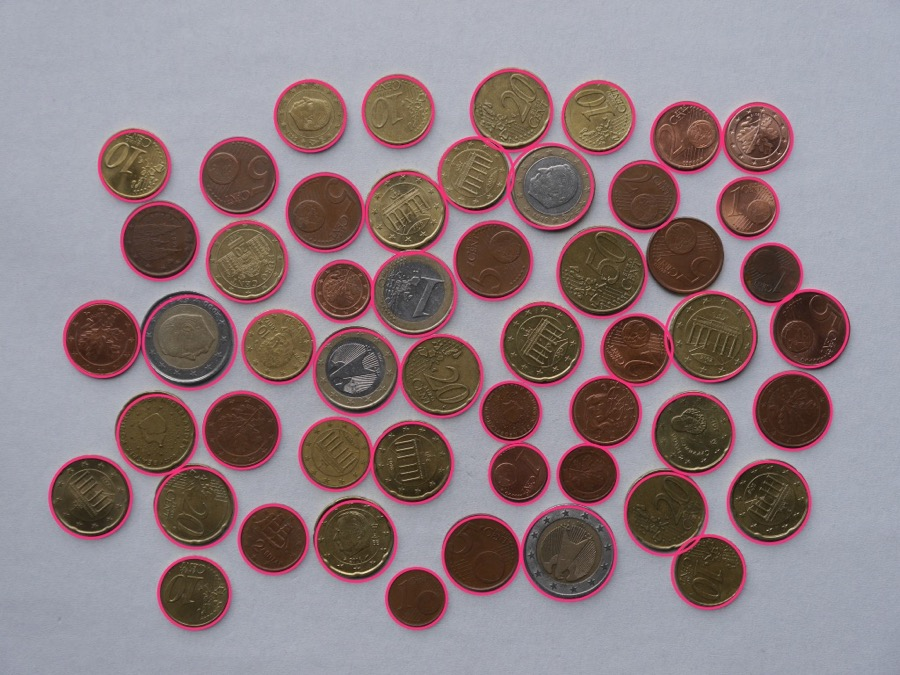
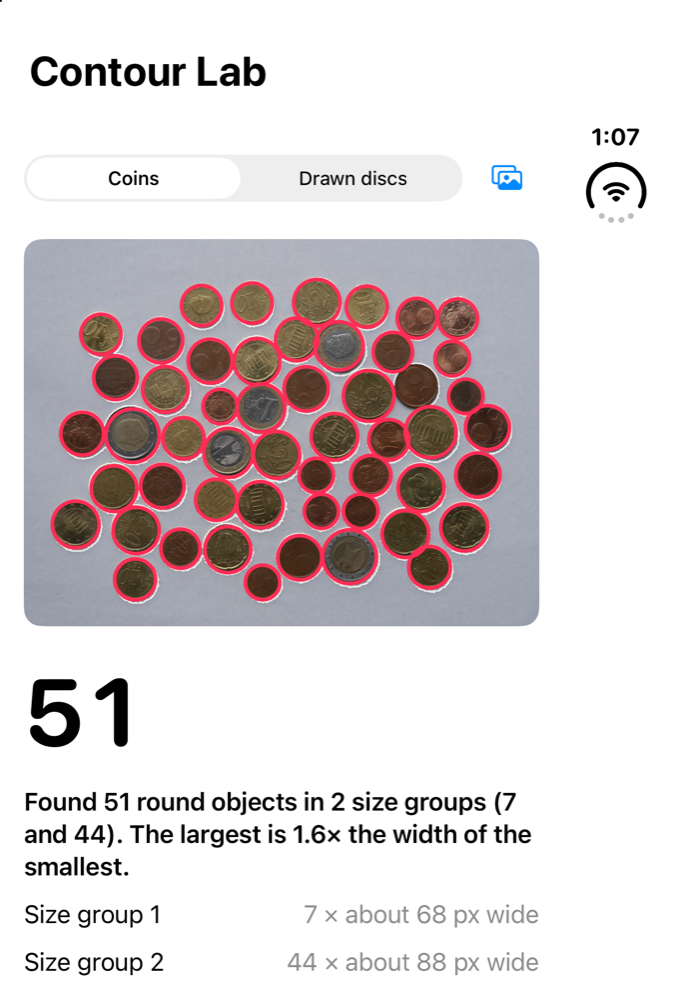
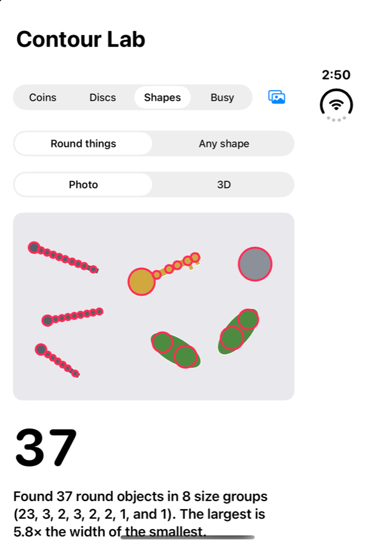
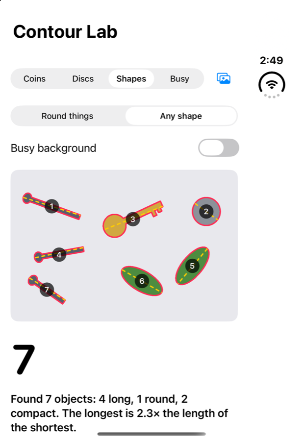
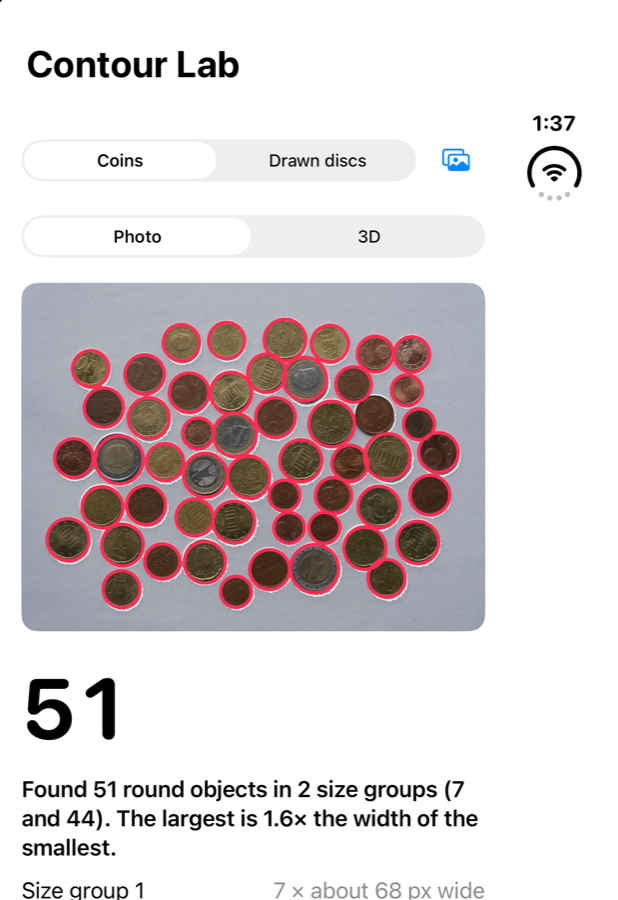
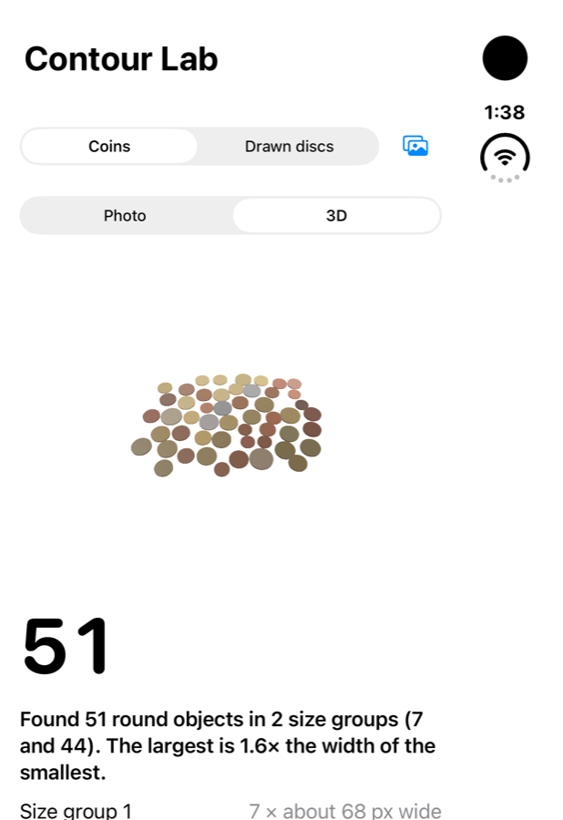

# Contour Lab

Count round things in a photo — coins, fruit, pills, seeds — on the iPhone, with Apple's Vision framework.

| Before | After: 51 coins found |
|---|---|
|  |  |



This repo started in 2020 as a sample for [VNDetectContoursRequest](https://developer.apple.com/documentation/vision/vndetectcontoursrequest) that drew every contour Vision found. Contour Lab turns it into a counter.

## How it counts

1. **Separate objects from the background.** `BackgroundMask` reads the background colour from the photo's border and marks every pixel that differs from it. Holes inside an object, like a shiny highlight, are filled.
2. **Outline them.** Vision's `VNDetectContoursRequest` draws the outlines of the object areas (the thin white lines in the app).
3. **Split touching objects.** Coins that touch make one outline. `CircleFinder` measures how far each object pixel is from the background; the centre of a round object is the farthest point, so each peak is one object and its height is the radius. Circles that cut deep into others (the shadow between two coins) are dropped.
4. **Say what was found.** `CountSummary` writes one sentence from those numbers, for example *"Found 51 round objects in 2 size groups (7 and 44)."*

Works best with a plain background that differs in colour from the objects, and with objects that are roughly round.

## Any shape

Switch to **Any shape** to count things that aren't round, such as screws, keys or leaves. Each separate area is one object. For each object the app reports:

- **Length:** its greatest extent, drawn as a dashed line.
- **Width:** its narrowest extent.
- **Roundness:** 4·area ÷ (π·length²). That is 1 for a disc, about 0.64 for a square and near 0 for a rod.

From those numbers each object is called long, round or compact. Length and width come from the object's convex hull, so they don't change when the object is turned. Objects that touch count as one.

| Round things: 37 circles, wrong | Any shape: 7 objects, right |
|---|---|
|  |  |

On a **busy background**, turn on *Busy background*. The colour mask is then replaced with Vision's `VNGenerateForegroundInstanceMaskRequest`, the model that lifts a subject out of a photo. It finds a photo's main subjects, so it suits a few objects better than a heap of coins. The model runs on devices and on the Mac (it passes the tests there), but not in the iOS Simulator, where the app says so.

## 3D table

Switch to **3D** and each counted object becomes a token on a table you can drag to turn. Each token keeps its place and relative size from the photo and is tinted with its average colour. It's built with RealityKit's `RealityView` and works in the simulator. The scale is relative: without a reference object it isn't real-world size.

| Photo | 3D |
|---|---|
|  |  |

What else Vision, ARKit and RealityKit could add, and what comes next, is in [docs/beyond-coins.md](docs/beyond-coins.md).

## Apple Intelligence and Siri

- **On-device model (iOS 27).** When Apple Intelligence is available, the app shows the photo to the on-device model with Foundation Models' `Attachment` and asks what the objects are. The model never counts: it's told not to, any reply containing a digit is dropped, and the number on screen always comes from Vision.
- **Siri and Shortcuts.** `CountObjectsIntent` counts the objects in a photo without opening the app. Say *"Count objects with Contour Lab"*, or use it in a shortcut or on the Action button.

## Run it

```bash
brew install xcodegen
xcodegen generate
open ContourLab.xcodeproj
```

Requires Xcode 27 and iOS 26 or later. The on-device model needs iOS 27 on a device with Apple Intelligence.

Run the counter's tests on the Mac (Vision runs on macOS too):

```bash
cd ContourLabKit && swift test
```

## Layout

| Path | What |
|---|---|
| `ContourLabKit/` | The counter as a Swift package: `BackgroundMask`, `ForegroundMask`, `CircleFinder`, `ContourCounter`, `ShapeCounter`, `ShapeMetrics`, `CountSummary`, and `ColorSampler` plus `TableScene` for 3D, with tests |
| `ContourLab/` | The SwiftUI app, the RealityKit table, the on-device model note and the App Intent |
| `project.yml` | XcodeGen project for iPhone and iPad |

## Licence

Code: MIT, see [LICENSE](LICENSE). The coin photo has been in this repo since 2020 and its original source isn't recorded; replace it before reusing it elsewhere.
