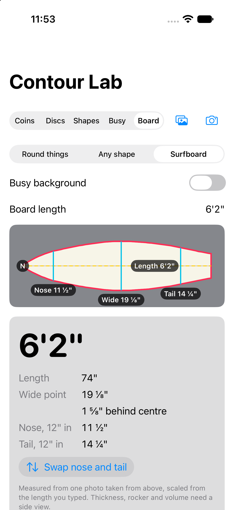

# Beyond coins

Contour Lab counts round things on a plain background. This note lists what else Apple's frameworks let it measure or count, how the results can move into 3D, and which features to build first. Researched 1 November 2026 against Apple's documentation (docs map dated 18 October 2026).

## What it can count or measure in 2D

| Objects | Vision request | What it adds | Fit |
|---|---|---|---|
| Coins, pills, seeds, buttons, cookies | Today's pipeline: colour mask, `VNDetectContoursRequest`, distance-map peaks | Count and relative size of round things, even when they touch | Works now |
| Screws, bolts, keys, leaves, Lego bricks | `VNDetectContoursRequest` outlines plus `ShapeMetrics` (area, perimeter, circularity) | Count non-round shapes that don't touch; sort by length, area or roundness | Small change: count outlines instead of circles when objects are elongated |
| Cookies on a tray, fruit in a bowl, things on a busy background | `GenerateForegroundInstanceMaskRequest` (Swift API) / `VNGenerateForegroundInstanceMaskRequest` | One mask per separate foreground object, without needing a plain background | Good: replaces the colour mask where the background isn't plain |
| Receipts, cards, documents, a sheet of paper as a reference | `DetectRectanglesRequest` | Finds four-cornered shapes and their corners | Good: the basis for real-world size (below) |
| Labels on jars, pill packs, coin years | `RecognizeTextRequest` | Reads text inside or next to each object | Later: pairs well with the on-device model note |
| "What should I look at?" | `GenerateAttentionBasedSaliencyImageRequest` / objectness saliency | A heat map of where the subject is, to crop before counting | Later: helps on cluttered photos |
| Hand-drawn shapes | Contours on a white page | A drawing becomes outlines that can be filled, measured or extruded | Good with 3D (below) |

## Real-world size

A photo alone gives sizes in pixels. Three ways to turn them into millimetres:

1. **A reference object in the photo.** This is the long-standing "pixels per metric" method ([PyImageSearch, 2016](https://pyimagesearch.com/2016/03/28/measuring-size-of-objects-in-an-image-with-opencv/)). A bank card (ISO/IEC 7810 ID-1, 85.60 × 53.98 mm) is easy to find with `DetectRectanglesRequest`, and is common and flat. Millimetres per pixel = 85.60 / the card's long side in pixels. It works on any iPhone and in the simulator, but only for objects lying flat at the card's distance, shot from straight above.
2. **LiDAR scene depth.** On iPhones and iPads with LiDAR, ARKit's `ARFrame.sceneDepth` (`ARConfiguration.FrameSemantics.sceneDepth`) gives the distance to every pixel. Pixel size × depth ÷ focal length gives millimetres, with no reference object. Apple's samples [Displaying a point cloud using scene depth](https://developer.apple.com/documentation/arkit/displaying-a-point-cloud-using-scene-depth) and [Capturing depth using the LiDAR camera](https://developer.apple.com/documentation/avfoundation/capturing-depth-using-the-lidar-camera) show both routes. This needs a real device.
3. **ARKit plane hit-test.** Without LiDAR, raycast the object's centre and edge onto a detected horizontal plane ([Tracking and visualizing planes](https://developer.apple.com/documentation/arkit/tracking-and-visualizing-planes)). It's less precise for small objects.

With millimetres, euro or rupee coins could be named by diameter and totalled. That needs about 0.5 mm accuracy, so check it on real photos before promising it.

## Surfboards

**Surfboard** mode turns one photo of a board lying on the floor into its outline and the measures shapers quote. It is a measuring tool: it reports sizes and never rates a board.

**What it measures.** `BoardOutline` takes the largest object `ShapeCounter` finds; any smaller ones are left out, and the result says how many. The long axis of the board's pixels is the stringer line, so the photo can be turned any way. Along that line it reads:

- **Length**, which is the length you type (see scale, below).
- **Wide point**: the widest width, and how far it sits ahead of or behind the middle of the length.
- **Nose and tail widths**, 12 inches (304.8 mm) from each end.
- **The outline** as half-widths at 61 even steps from nose to tail, for drawing now and exporting later.

The narrower, more pointed end is taken as the nose, because tails are cut off (squash, square, swallow). A round-nosed longboard with a pin tail can fool that, so the result has a *Swap nose and tail* button.

**Scale.** You type the board's length as it is stamped on the stringer, such as `6'2"`, and every other measure is scaled from it. A bank card, the reference for coins above, is the wrong tool here: on a photo wide enough for a 6-foot board the card covers about 4% of the frame, so one pixel of error on the card is 2–3% on every measure, close to an inch of length. The board's own length spans the whole photo, so the same pixel costs about 0.1%. `ScaleSource.lidarDepth` is reserved for the LiDAR step below.

**How to shoot it.**

1. Lay the board deck up on a plain floor that differs from it in colour: a white board on grey concrete or dark grass, not on white tiles. On a patterned floor, turn on *Busy background*; it uses Vision's subject model, which runs on devices but not in the Simulator.
2. Stand on something and shoot from straight above, with the camera over the middle of the board. A photo taken at an angle makes the far end look narrower.
3. Fit the whole board in the frame with a little floor around it, and keep feet, leashes and other boards out of it.
4. Use the main (1×) camera rather than the ultra-wide, whose edges bend straight lines.

**Accuracy on drawn boards.** The tests draw a 6'2" shortboard and a 9'0" longboard from known measures, flat, turned, on a striped floor and next to a second board. Widths come out within ¼ inch (½ inch on the striped floor), and the board is within 1/16 inch of its widest where the wide point is reported. The wide point's *position* is looser, within 1½ inches: near it the rails run almost parallel, and on the longboard the width stays within 1/50 inch of its widest for about 4 inches. No photo, and no tape measure, pins it closer. Real photos add lens distortion and camera tilt, so check them against a tape before trusting the last eighth.

**What one photo can't measure.** A photo from above only sees the outline. *Thickness*, *rocker* (how much the nose and tail curve up) and *volume* (in litres, which needs thickness and the shape of the rails across the whole board) all need a view from the side or depth.

**Next: LiDAR.** On an iPhone or iPad with LiDAR, ARKit's `ARFrame.sceneDepth` gives the distance to every pixel. With it the outline could be scaled with nothing typed (`ScaleSource.lidarDepth`), and a pass along the board's side, or a scan of it standing on its rail, could give thickness and rocker, and with the outline an estimate of volume. That needs a real device, so it isn't built yet.

## Into 3D with RealityKit

- **Tokens.** Each counted object becomes a short cylinder: `MeshResource.generateCylinder`, sized from Vision's measured diameter and tinted with the object's average colour from the photo. A `RealityView` with `realityViewCameraControls(.orbit)` (iOS 18+) lets you turn the table around. It works in the simulator with no camera.
- **Extruded outlines.** `MeshResource(extruding: Path, extrusionOptions:)` (iOS 18+, macOS 15+, visionOS 2+) turns any closed outline into a solid. The path must be closed and must not cross itself, so simplify Vision's outline first. A hand-drawn star or a leaf becomes a 3D piece. Public write-ups: [Step Into Vision: Extruding Meshes](https://stepinto.vision/example-code/realitykit-basics-extruding-meshes/) and [Andre Salla: a custom 3D shape from a SwiftUI shape](https://andresalla.com/en/how-to-create-a-custom-3d-shape-for-realitykit-on-visionos-from-a-swiftui-shape/).
- **AR overlay.** In an AR session, place each token where its object sits on the table, using a plane anchor or LiDAR depth. Counts and sizes then float above the real coins. [Placing objects and handling 3D interaction](https://developer.apple.com/documentation/arkit/placing-objects-and-handling-3d-interaction) covers the anchoring.
- **visionOS.** The same tokens go in a volumetric window, and in a full space ARKit's scene reconstruction can mesh the table ([Applying mesh to real-world surroundings](https://developer.apple.com/documentation/visionos/applying-mesh-to-real-world-surroundings)). Apps don't get the main camera feed without an enterprise entitlement, so the visionOS app would count photos you hand it, not the live view.

## Picks

1. **Lift into 3D (built in this branch).** Counted objects become colour-matched tokens on a table you can orbit. It works in the simulator, and it is the base the AR overlay and the visionOS volume reuse.
2. **Real size from a bank card.** Find the card with `DetectRectanglesRequest`, convert pixels to millimetres, and show each object's diameter. Tokens then become life-size, which is what AR placement needs.
3. **Any shape, any background (counting built).** `ShapeCounter` counts each separate area and measures its length, width and roundness. `ForegroundMask` (`VNGenerateForegroundInstanceMaskRequest`) replaces the colour mask on busy backgrounds. Still to do: extrude each outline into a 3D piece instead of drawing a cylinder.
4. **Surfboards (built).** One photo gives a board's outline, wide point and nose and tail widths, scaled from its typed length. Thickness, rocker and volume wait for the LiDAR step.
